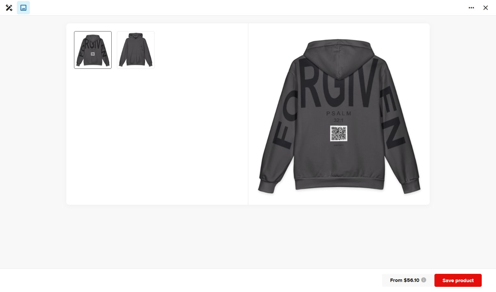
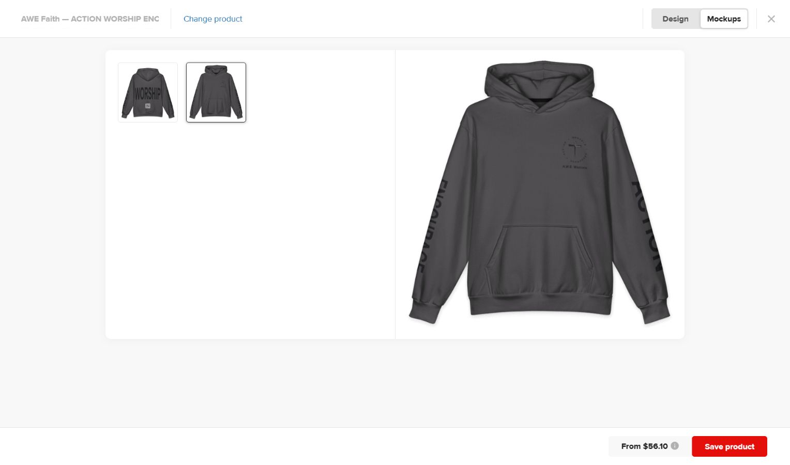
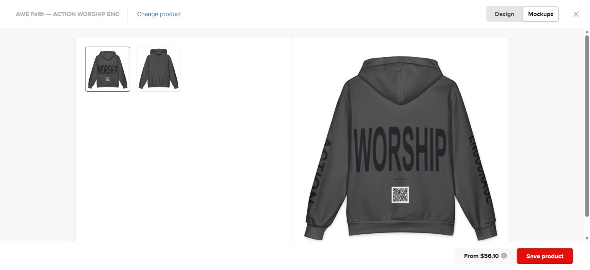

# AWE Faith hoodie modeling handoff

Chat title: AWE Faith — Hoodie Modeling & Printful

Both products are now published in Printful’s existing A.W.E. Missions store, with 11 sizes from 2XS through 6XL.

- [Published FORGIVEN](https://www.printful.com/dashboard/product-templates/published/17056855/482307371)
- [Published ACTION / WORSHIP / ENCOURAGE](https://www.printful.com/dashboard/product-templates/published/17056855/482308114)

FORGIVEN is a single word: FO reads upward along the left arm, RGIV spans the upper back, EN reads downward along the right arm. The larger PSALM 32:1 reference and real app QR sit beneath it.

WORSHIP spans the back with ACTION down the left sleeve and ENCOURAGE down the right sleeve. It retains Ephesians 2:8–9 and the real app QR.

Both have the recreated A.W.E. Missions ring-and-cross logo in the wearer’s upper-left chest pocket position. Charcoal printed panels #454345, black ink and black stitching on Printful’s All-Over Print Oversized Cotton Hoodie. Retail prices $73–$86 with default 30% markup. Physical sample not ordered.

To continue the same local chat on a phone, use ChatGPT mobile’s Codex/Remote with this PC paired. On desktop: Settings → Connections → Control this PC → Set up/Add, then scan the pairing QR with the phone and verify the same account/workspace. Keep the PC online and the desktop app running. A share snapshot does not provide live control. See https://learn.chatgpt.com/docs/remote-connections.
